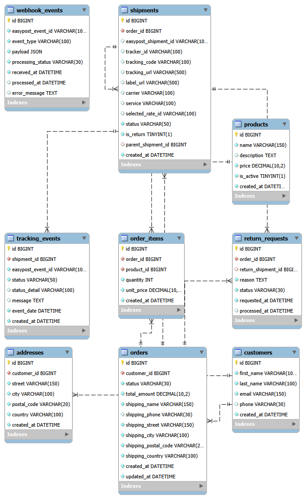

# E-commerce Shipping Integration

A backend-oriented application that integrates an e-commerce order management system with the **EasyPost API** to support shipment creation, tracking, and return management.

## Overview

This project is a university team project developed to demonstrate the integration of an e-commerce system with an external courier and shipping service.

The application focuses on managing customers, products, orders, shipments, tracking events, and return requests through a centralized backend system.

The goal is to provide a structured solution for managing the shipping lifecycle, from order creation to delivery tracking and returns.

## Main Features

Planned functionality:

- Customer and address management
- Product and order management
- Order item and pricing management
- Shipment creation and management through EasyPost
- Shipment tracking and tracking event history
- EasyPost webhook event processing
- Return request submission and management
- Administrative shipment and return management

## Technology Stack

| Technology      | Purpose                           |
| --------------- | --------------------------------- |
| Java            | Backend programming language      |
| Spring Boot     | Backend application framework     |
| MySQL           | Relational database               |
| MySQL Workbench | Database design and management    |
| EasyPost API    | Shipping and tracking integration |
| Git & GitHub    | Version control and collaboration |

## Database Design

The application uses a relational MySQL database.

The initial database schema contains nine tables:

1. `customers`
2. `addresses`
3. `products`
4. `orders`
5. `order_items`
6. `shipments`
7. `tracking_events`
8. `webhook_events`
9. `return_requests`

The database schema and ER diagram are available in the `database/` directory.

### Entity Relationship Diagram



### Database Scripts

The SQL script for creating the database structure is available here:

`database/scripts/01_create_schema.sql`

## Project Structure

```text
ecommerce-shipping-integration/
│
├── database/
│   ├── scripts/
│   │   └── 01_create_schema.sql
│   │
│   └── diagrams/
│       ├── prodavnica_db.mwb
│       └── ERD.png
│
├── docs/
│
├── .gitignore
└── README.md
```

The project structure will be expanded as backend development progresses.

## Team Responsibilities

The project is developed by a team of three students.

| Team Member | Responsibilities                                                                     |
| ----------- | ------------------------------------------------------------------------------------ |
| Person 1    | Database design and implementation; customer, address, product, and order management |
| Person 2    | EasyPost integration, shipment management, tracking, and webhook handling            |
| Person 3    | Return request management, administrative functionality, and statistics              |

## Project Status

**Current status: Initial database design and GitHub repository setup completed.**

Upcoming development milestones:

- Spring Boot project initialization
- Database integration with Spring Data JPA
- Customer and order REST API
- EasyPost API integration
- Shipment tracking and webhook processing
- Return management functionality
- Testing and documentation

## Academic Project

Developed as a university team project focused on backend development, relational database design, REST API development, and third-party API integration.
